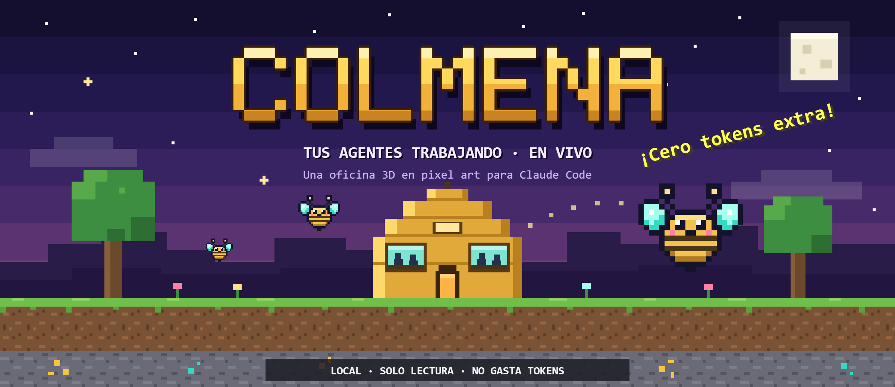
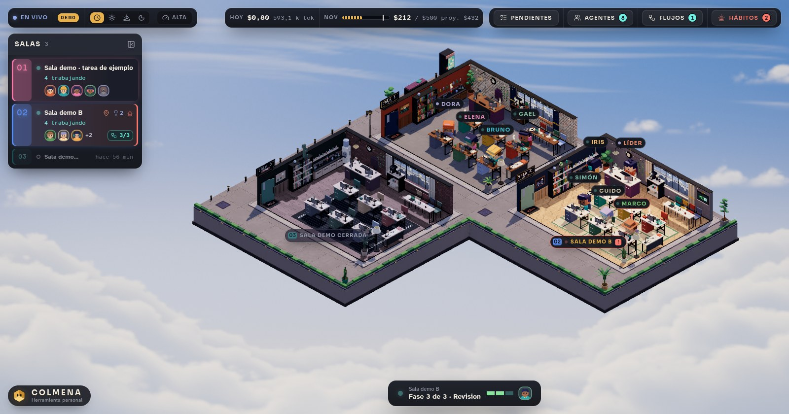
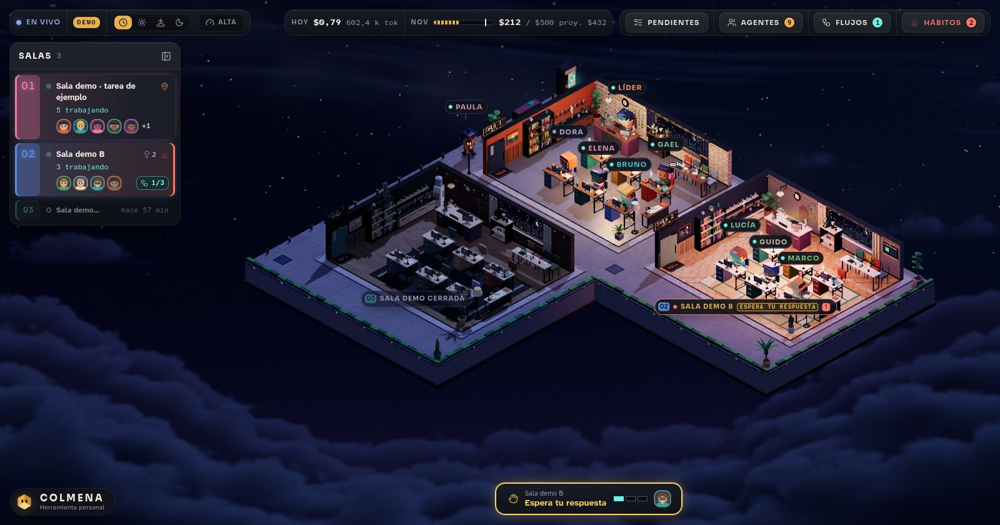
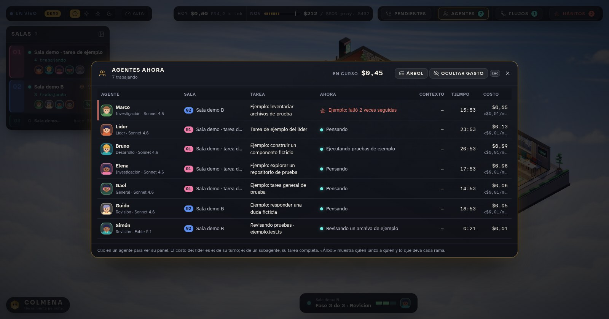
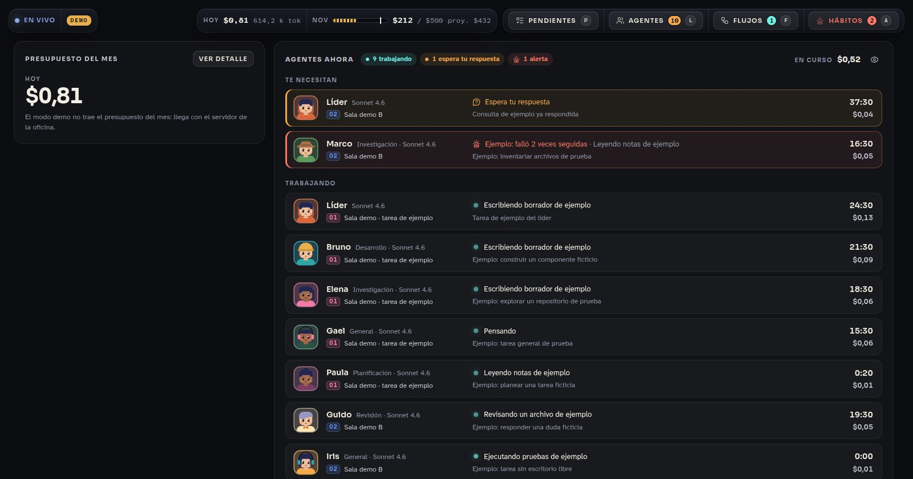
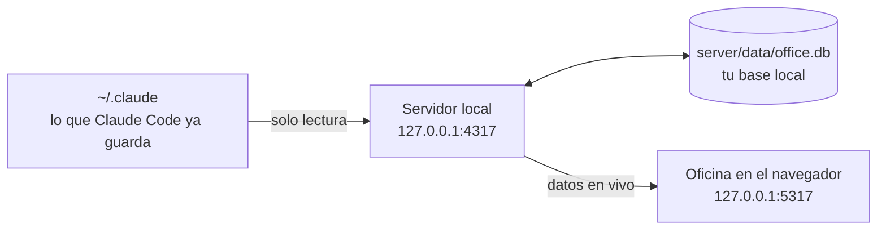

<h1 align="center">Colmena · Tus agentes trabajando</h1>

<p align="center">
  Una oficina 3D en miniatura para ver, en vivo, qué hacen tus sesiones de Claude Code<br>
  y cuánto llevas gastado contra el presupuesto del mes.
</p>

<p align="center">
  <a href="#empezar-en-3-pasos"><b>Empezar</b></a> ·
  <a href="#recorrido"><b>Recorrido</b></a> ·
  <a href="#controles"><b>Controles</b></a> ·
  <a href="#rendimiento"><b>Rendimiento</b></a> ·
  <a href="#privacidad"><b>Privacidad</b></a> ·
  <a href="#si-algo-falla"><b>Si algo falla</b></a>
</p>



<p align="center"><sub>Las capturas son del modo demo: datos de ejemplo.</sub></p>

## Qué es

- **Una sala por sesión, un escritorio por agente.** Cada sesión de Claude Code abierta es una sala; el líder y
  cada agente que lanza tienen su puesto, y se ve quién escribe, quién espera tu respuesta y quién terminó.
- **El dinero siempre a la vista.** Lo gastado hoy, el mes contra el tope y el ritmo de la última hora están en
  el centro de la barra superior, y avisa antes de que te pases.
- **Pensada para quedarse abierta.** Baja sola su consumo cuando no la miras y funciona en equipos sin tarjeta
  gráfica dedicada.

> [!IMPORTANT]
> **Cero tokens extra.** Colmena solo lee lo que Claude Code ya guarda en `~/.claude`
> (`%USERPROFILE%\.claude` en Windows). No escribe ahí, no instala hooks y no llama a la API de Anthropic.
> Todo corre en tu equipo y solo escucha en `127.0.0.1`.


## Empezar en 3 pasos

**Necesitas:** Windows, [Node.js 24 LTS](https://nodejs.org) (24.15 o superior), Edge o Chrome, y haber usado
Claude Code al menos una vez en ese equipo.

**1. Descarga el proyecto**

```powershell
git clone https://github.com/Yeisoncgy/Oficina-de-Agentes-Yeison-Moreno.git Colmena
cd Colmena
```

**2. Instala** (una sola vez)

```powershell
npm ci
```

**3. Ábrela**: doble clic en **`Colmena.cmd`**.

Se abre sola en el navegador, en http://127.0.0.1:5317. La primera vez tarda un poco más: compila la oficina y
lee tu historial de Claude Code, mostrando el avance.

| Forma de abrirla | Para qué |
|:---|:---|
| Doble clic en `Colmena.cmd` | El uso diario. Sin ventana de terminal; se apaga sola 3 minutos después de cerrar la última pestaña. |
| `npm run colmena` | Lo mismo, con una consola que muestra el estado del servidor, la oficina y el historial. Ciérrala para apagar. |
| `npm start` | Compila y sirve la versión optimizada desde la terminal. `Ctrl+C` la apaga. |
| `npm run dev` | Solo para programarla: recarga al tocar el código, pero va más lenta. |

<details>
<summary><b>Acceso directo en el escritorio, modo demo y otra carpeta de Claude</b></summary>

<br>

**Acceso directo.** Crea uno con este destino (cambia la carpeta por la tuya) y el icono `launcher\colmena.ico`:

```
wscript.exe "C:\ruta\a\Colmena\launcher\Colmena.js"
```

**Modo demo.** http://127.0.0.1:5317/?demo=1 muestra la oficina con datos de ejemplo simulados en el
navegador. Sirve para enseñarla sin mostrar tu trabajo.

**Otra carpeta de Claude.** Si Claude Code guarda sus datos en otro lugar, indícalo con `CLAUDE_HOME`:

```powershell
$env:CLAUDE_HOME = "C:\ruta\a\tu\carpeta\.claude"
npm start
```

**Primer arranque.** Pregunta tu nombre (es el del líder: sale en tu escritorio, el ranking y Hábitos) y
muestra una guía corta, que se repite con el botón **Guía** dentro de Hábitos.

</details>


## Recorrido

### La oficina

Cada sala es una sesión. Los agentes entran, se sientan directo en su escritorio y trabajan; el líder teclea
mientras su sesión está activa. La luz sigue la hora real, o la fijas tú desde la barra.

| Día | Noche |
|:---:|:---:|
|  |  |

Doble clic en una sala la enfoca y abre su panel: cada turno del líder con su costo, las tareas, y los archivos
que tocó cada agente, con aviso cuando dos editaron el mismo.

### Quién hace qué

**Agentes ahora** (`L`) responde de un vistazo quién trabaja, en qué, desde cuándo y cuánto lleva. La vista de
**Árbol** muestra quién lanzó a quién y cuánto cuesta cada rama, con el tamaño del contexto de cada agente, su
ritmo por minuto y cuánto lleva sin actividad o esperando tu respuesta.



El panel de un agente muestra su contexto actual, lo que cuesta su próxima llamada solo por releerlo y la línea
de tiempo de sus acciones (hora, duración, fallos y bloqueos).

### Cuánto llevas gastado

La barra superior tiene tres grupos y el del centro es el dinero: **hoy**, **el mes contra el tope** y **el
ritmo** (gasto de la última hora y el día en que se acaba el presupuesto, o el día en que ya se pasó). Un clic en
el mes abre el presupuesto.

- **Avisos del mes.** Al cruzar el 50, 75, 90 y 100 % sale una franja en la app y un aviso del sistema. También
  avisa cuando la proyección pasa el tope, cuando hoy ya gastaste más de lo recomendado por día y cuando un
  proyecto pasa su tope.
- **Topes por proyecto y por semana.** A cada proyecto se le pone un tope mensual y se ve lo que le toca a la
  semana en curso.
- **Cierre de mes.** Cada mes con datos queda con lo gastado, la parte en flujos, lo descartado y lo más caro.

**Costos** reparte el gasto por tipo de token (releer contexto, contexto nuevo, respuestas) y muestra qué
herramienta llena más el contexto.

> [!NOTE]
> Los USD son el **valor equivalente de la API**, no un cobro de tu plan. El presupuesto por defecto es de
> 500 USD al mes y se cambia en Hábitos > Gasto > Presupuesto. "Ocultar gasto" esconde las cifras hasta que las
> vuelvas a mostrar.

### Flujos

Un flujo en curso (`F`) vive en su sala: sus fases, sus agentes y qué parte de lo que queda del mes se llevaría.
Al terminar deja su cierre: costo por fase y por rol, lo descartado y el primer pronóstico contra el costo real.

### Pendientes

Tu lista de cosas por hacer (`P`), una sola para toda la herramienta. Escribes, Enter, y al terminar marcas la
casilla. Separa **Por hacer** y **Hechas**, con la fecha de cada una y las hechas agrupadas por día. Borrar se
puede deshacer durante 5 segundos (o con `Ctrl+Z`). Se guarda en tu base local.

### Vista ligera

Los mismos datos en vivo, sin la oficina 3D: botón **Vista ligera** en la barra, o `?lite=1` en la dirección.
Es la opción para una pantalla secundaria o un equipo muy justo.



### Y además

| Panel (dentro de Hábitos, `A`) | Qué resuelve |
|:---|:---|
| **Ranking** | Qué proyectos y qué tipos de agente gastan más, por periodo. |
| **Tareas** | Buscador con filtros (proyecto, quién, cómo terminó, costo mínimo, periodo) y cómo terminó cada una. |
| **Sesiones** | Todas las sesiones con gasto, no solo las que caben en la oficina. |
| **Hábitos** | Hallazgos sobre cómo trabajas: lo que sale caro y cómo evitarlo. |
| **Comparador** | Qué combinación rinde más: cada modelo en cada rol, con o sin skill, y los flujos (costo por tarea terminada). |
| **Simulador** | "¿Y si…?": el mismo trabajo cotizado con otro modelo por rol. |
| **Informe** | El resumen de los últimos 7 días o del mes, listo para copiar. Se calcula en local. |
| **Reglas** | Los avisos y sus umbrales, atados al saldo: una sesión no debería pasar en un día del recomendado por día, un flujo del 25 % de lo que queda del mes y un agente del 10 %. |
| **Precios** | El precio de cada modelo. Cada cambio recotiza todo el historial desde la base local, sin releer nada. |
| **Sistema** | Avisos del sistema operativo, "Seguir vigilando sin pestañas", la salud de la lectura y el botón para apagar el servidor. |


## Controles

### Teclado

| Tecla | Qué hace |
|:---:|:---|
| `L` | Abre o cierra **Agentes ahora** |
| `P` | Abre o cierra tus **Pendientes** |
| `A` | Abre o cierra **Hábitos** (gasto, eficiencia, reglas, precios y sistema) |
| `H` | Abre o cierra ese panel en la última pestaña vista |
| `F` | Lleva a la sala del flujo en curso y abre su panel |
| `Tab` | Despliega o pliega la lista de salas |
| Flechas | Con la lista desplegada, pasan a la sala anterior o siguiente |
| `Esc` | Cierra lo que está arriba |

### Cámara

| Acción | Ratón | Teclado |
|:---|:---|:---|
| Moverse | Arrastrar con el clic izquierdo | Flechas |
| Girar | Arrastrar con el clic derecho (o `Ctrl` + clic) | `Q` / `E` |
| Zoom | Rueda | `+` / `-` |
| Enfocar una sala | Doble clic en la sala | |
| Ver todo | Doble clic en el vacío | `0` |

### Barra superior

| Grupo | Qué tiene |
|:---|:---|
| **Izquierda · vista** | Estado de la conexión, Vista ligera, la hora de la oficina (automática, día, atardecer, noche) y la calidad. |
| **Centro · dinero** | Hoy, el mes contra el tope y el ritmo. |
| **Derecha · paneles** | Pendientes, Agentes, Flujos y Hábitos, cada uno con su insignia. |

La barra se ajusta sola a lo que cabe: en pantallas angostas recorta primero lo decorativo (letras de atajo,
textos de los botones) y deja las cifras del dinero para lo último.


## Rendimiento

Colmena está hecha para quedarse abierta mientras trabajas en otra cosa, también en un portátil sin tarjeta
gráfica dedicada.

| Calidad | Para qué equipo | Qué cambia |
|:---|:---|:---|
| **Alta** | Tarjeta dedicada | Sombreado de contacto y máxima nitidez. |
| **Media** | Gráficos integrados | Sin sombreado de contacto. |
| **Baja** | Sin aceleración | Dibuja a menor resolución. La luz y los materiales son los mismos. |

- **Automática por defecto.** Arranca según la tarjeta que detecta y, si el equipo no alcanza, baja sola un
  nivel. El botón del velocímetro en la barra la fija a mano y lo recuerda en ese navegador.
- **Dibuja solo lo necesario.** 60 cuadros por segundo mientras la usas, 30 cuando está quieta, 20 si la ventana
  está a la vista pero trabajas en otra, y nada con la pestaña oculta.
- **Sombras bajo demanda.** Solo se recalculan cuando alguien camina.
- **Interfaz liviana.** Sin desenfoques de fondo, que es lo que más pesa en equipos sin tarjeta dedicada.

**Medir un equipo.** Agrega `?perf=1` a la dirección y aparece abajo a la izquierda una lectura en vivo: cuadros
por segundo reales y buscados, milisegundos que tarda la tarjeta en un cuadro, y el nivel de calidad.

<details>
<summary><b>Todos los parámetros de la dirección</b></summary>

<br>

Se agregan al final de http://127.0.0.1:5317, por ejemplo `/?lite=1` o `/?calidad=media&perf=1`.

| Parámetro | Qué hace |
|:---|:---|
| `?demo=1` | Datos de ejemplo simulados en el navegador. |
| `?lite=1` | Vista ligera, sin la oficina 3D. |
| `?calidad=alta\|media\|baja` | Fija la calidad para esa carga. |
| `?perf=1` | Muestra la lectura de rendimiento en vivo. |
| `?hora=18.5` | Fija la hora de la luz (0 a 24, con decimales). |
| `?fx=0` | Apaga todo el revelado de la imagen. |

</details>


## Privacidad

- **Solo lectura sobre Claude Code.** Lee `~/.claude` y nunca escribe ahí.
- **Solo en tu equipo.** Escucha en `127.0.0.1`; nadie más en la red puede abrirla.
- **Tu base es tuya.** `server/data/office.db` guarda el historial leído, tus notas, nombres de salas, presupuesto,
  reglas, pendientes y tu nombre. No la subas a ningún repositorio: el `.gitignore` ya la deja fuera.
- **No la borres para actualizar.** Las notas, nombres, presupuesto y reglas no se recuperan.
- **Ojo al proyectar.** El panel de un agente muestra prompts y respuestas completos. Ciérralo antes de
  compartir pantalla, o usa el modo demo.

## Cómo funciona



El servidor vigila los archivos de sesión de Claude Code, los interpreta (agentes, tareas, tokens, flujos), les
pone precio y guarda el resultado en una base SQLite local. La oficina recibe los cambios en vivo y los dibuja.
Ninguna parte del recorrido sale de tu equipo.

<details>
<summary><b>Cómo se calculan los precios</b></summary>

<br>

- Ningún modelo de una familia conocida queda en cero. Si un modelo no está en la tabla se cotiza con un precio
  **estimado**: el que reproduce lo que Claude Code calculó en su propio registro, o el del modelo más nuevo de
  su familia. Lo estimado se marca y se suma aparte en Presupuesto y Costos.
- En Hábitos > Reglas > Precios se fija el precio correcto de cualquier modelo.
- El gasto que Claude Code hace por debajo (búsquedas y resúmenes) y que no aparece en las conversaciones se
  suma desde su registro. Costos trae la conciliación: lo que dice Claude Code contra lo que leyó Colmena.

</details>


## Si algo falla

| Qué ves | Qué hacer |
|:---|:---|
| No abre con doble clic | El motivo queda en `server\data\lanzador-error.txt`. Prueba `npm run colmena` para verlo en consola. |
| Puerto 4317 o 5317 ocupado | Casi siempre es otra Colmena abierta: ciérrala y vuelve a abrir. |
| "Sin conexión" | La oficina no encuentra al servidor: revisa que siga corriendo y usa **Reintentar**. |
| Pantalla vacía al arrancar | Está leyendo tu historial por primera vez; muestra el avance. |
| "Todavía no hay salas" | Solo salen las sesiones abiertas y las que tuvieron movimiento hoy. Si falta alguna, revisa `CLAUDE_HOME`. |
| No se dibuja la oficina 3D | El navegador no tiene WebGL 2. Los paneles funcionan igual; usa la vista ligera. |
| Se siente lenta | Baja la calidad con el botón del velocímetro y mira la lectura de `?perf=1`. |
| Falla `npm ci` | Revisa que `node -v` diga 24.15 o más. |

## Desarrollo

```powershell
npm run dev         # servidor y oficina con recarga al tocar el código
npm run typecheck
npm run test
npm run build
```

| Carpeta | Qué hay |
|:---|:---|
| `server/` | Fastify + SQLite: lectura de `~/.claude`, precios, presupuesto, reglas y la API local. |
| `web/` | React + Three.js (React Three Fiber): la oficina 3D, los paneles y la vista ligera. |
| `shared/` | El contrato de datos que comparten servidor y oficina. |
| `launcher/` | El lanzador de `Colmena.cmd` y de `npm run colmena`. |
| `docs/` | Las imágenes de este documento. |
