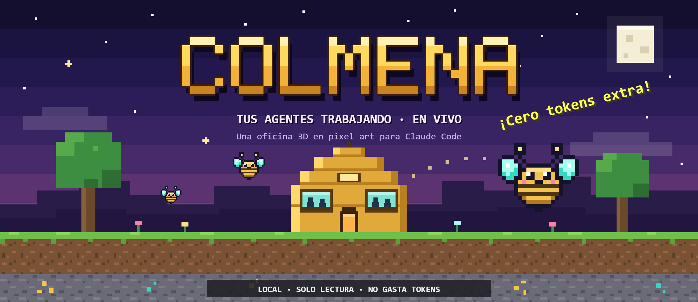

# Colmena · Tus agentes trabajando

Una oficina 3D en pixel art para ver qué hacen tus sesiones de Claude Code: una sala por sesión, un
escritorio por agente, y sus tareas, tokens y costo equivalente en vivo.

> **Cero tokens extra.** Colmena solo lee lo que Claude Code ya guarda en `~/.claude`
> (`%USERPROFILE%\.claude`). No escribe ahí, no instala hooks y no llama a la API de Anthropic.


## Requisitos

| Requisito | Detalle |
|:---|:---|
| Sistema | Windows |
| Node.js | **24 LTS, versión 24.15 o superior** |
| Navegador | Edge o Chrome con WebGL 2. Sin WebGL 2 no se dibuja la oficina 3D, pero los paneles funcionan. |
| Claude Code | Haberlo usado al menos una vez, para que exista `~/.claude`. |

## Instalar y abrir

```powershell
npm ci
npm run dev
```

Levanta el server (puerto 4317) y la web (puerto 5317). Abre http://127.0.0.1:5317 y apágala con Ctrl+C.

También puedes abrirla con doble clic en **`Colmena.cmd`**: no muestra terminal, abre la oficina en el
navegador y se apaga sola 3 minutos después de cerrar la última pestaña. Para un acceso directo, usa este
destino (cambiando la carpeta por la tuya) y el icono `launcher\colmena.ico`:

```
wscript.exe "C:\ruta\a\Colmena\launcher\Colmena.js"
```

`npm run colmena` abre una consola con el estado del servidor, la oficina y el historial.

### Primer arranque

- Pregunta tu nombre: es el del líder y sale en tu escritorio, el ranking y Hábitos.
- Muestra una guía corta (se repite con el botón **Guía** dentro de Hábitos).
- Lee tu historial de Claude Code y muestra el avance. La primera lectura es la más larga.

### Modo demo y otra carpeta de Claude

- http://127.0.0.1:5317/?demo=1: la oficina con datos de ejemplo, simulados en el navegador.
- Si Claude Code guarda sus datos en otra carpeta, indícala con `CLAUDE_HOME`:

  ```powershell
  $env:CLAUDE_HOME = "C:\ruta\a\tu\carpeta\.claude"
  npm run dev
  ```

## Controles

| Tecla | Qué hace |
|---|---|
| `L` | Abre o cierra "Agentes ahora": quién trabaja, en qué, desde cuándo y cuánto lleva |
| `A` | Abre o cierra Hábitos (gasto, ranking y reglas) |
| `H` | Abre o cierra ese panel en la última pestaña vista |
| `F` | Lleva a la sala del flujo en curso y abre su panel |
| `Tab` | Despliega o pliega la lista de salas |
| Flechas | Con la lista desplegada, pasan a la sala anterior o siguiente |
| `Esc` | Cierra lo que está arriba |

Cámara: arrastra con el clic izquierdo para moverte y con el derecho (o Ctrl+clic) para girar; la rueda hace
zoom. Doble clic en una sala la enfoca y doble clic en el vacío muestra todo. Con el teclado: flechas, `Q`/`E`
para girar, `+`/`-` para zoom y `0` para ver todo.

## Privacidad

- La base local `server/data/office.db` es solo tuya (historial leído, notas, nombres de salas, presupuesto,
  reglas y tu nombre). No la subas: el `.gitignore` ya la deja fuera.
- No borres la base para actualizar: las notas, nombres, presupuesto y reglas no se recuperan.
- El panel de un agente muestra prompts y respuestas completos. Ciérralo antes de proyectar la pantalla.
- Colmena solo escucha en `127.0.0.1`.

## Costos

- Los USD son el **valor equivalente de la API**, no un cobro del plan.
- El presupuesto mensual por defecto es 500 USD; se cambia en Hábitos > Gasto > Presupuesto.
- "Ocultar gasto" lo esconde hasta que lo vuelvas a mostrar.

## Si algo falla

- **Puerto 4317 o 5317 ocupado:** casi siempre es otra Colmena abierta; ciérrala y vuelve a abrir.
- **"Sin conexión":** la web no encuentra al server; revisa que siga corriendo y usa Reintentar.
- **Pantalla vacía al arrancar:** está leyendo tu historial por primera vez.
- **"Todavía no hay salas":** se muestran las sesiones abiertas y las que tuvieron movimiento hoy; revisa
  `CLAUDE_HOME`.

## Desarrollo

```powershell
npm run typecheck
npm run test
npm run build
```
